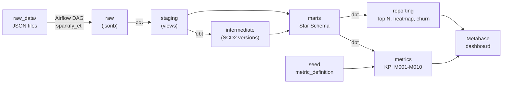
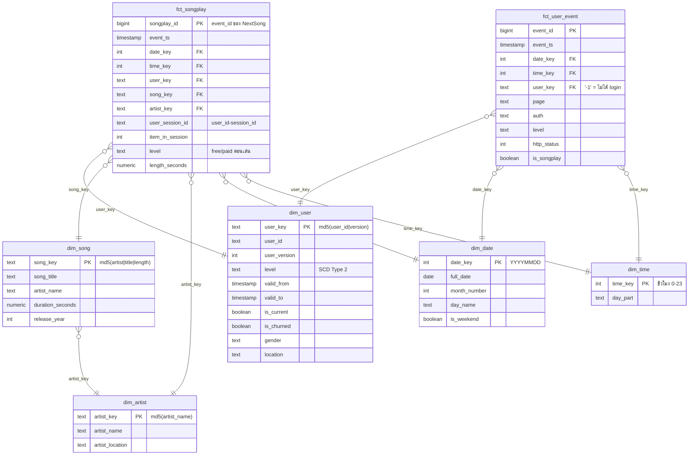

# Sparkify Music Data Warehouse

Data Warehouse ของ **Sparkify** บริษัทสตรีมมิงเพลงสมมติ สร้างจาก event log ของผู้ใช้ เพื่อตอบคำถามธุรกิจเรื่องพฤติกรรมการฟังเพลง การ Upgrade และการยกเลิกบริการ (churn)

Pipeline ทั้งหมดรันในเครื่องด้วย Docker: **Airflow** โหลดข้อมูลดิบ → **dbt** แปลงเป็น Star Schema และ KPI → **Metabase** แสดงผลเป็น dashboard


---

## สารบัญ

1. [ภาพรวมสถาปัตยกรรม](#1-ภาพรวมสถาปัตยกรรม)
2. [คำถามธุรกิจและผลลัพธ์](#2-คำถามธุรกิจและผลลัพธ์)
3. [ข้อมูลต้นทาง](#3-ข้อมูลต้นทาง)
4. [โครงสร้างโปรเจกต์](#4-โครงสร้างโปรเจกต์)
5. [สิ่งที่ต้องมีก่อนเริ่ม](#5-สิ่งที่ต้องมีก่อนเริ่ม)
6. [วิธีรันตั้งแต่ต้น (Quick Start)](#6-วิธีรันตั้งแต่ต้น-quick-start)
7. [ผลลัพธ์ที่ควรได้ (ใช้ตรวจว่าทำถูก)](#7-ผลลัพธ์ที่ควรได้-ใช้ตรวจว่าทำถูก)
8. [Data Model](#8-data-model)
9. [KPI Catalog](#9-kpi-catalog)
10. [Data Quality Tests](#10-data-quality-tests)
11. [การตัดสินใจออกแบบที่สำคัญ](#11-การตัดสินใจออกแบบที่สำคัญ)
12. [ข้อจำกัดและ Known Issues](#12-ข้อจำกัดและ-known-issues)
13. [Troubleshooting](#13-troubleshooting)
14. [คำสั่งที่ใช้บ่อย](#14-คำสั่งที่ใช้บ่อย)
15. [แหล่งข้อมูลและ License](#15-แหล่งข้อมูลและ-license)

---

## 1. ภาพรวมสถาปัตยกรรม



| Service | หน้าที่ | URL / Port บนเครื่อง | Login (สำหรับ dev เท่านั้น) |
|---|---|---|---|
| PostgreSQL 16 | ฐานข้อมูล warehouse `sparkify_dw` และ metadata ของ Airflow | `localhost:35432` | `dw_user` / `dw_pass` |
| Airflow 3.2.2 | รัน DAG `sparkify_etl` | http://localhost:38080 | `airflow` / `airflow` |
| dbt (ใน Airflow) | แปลงข้อมูล + ทดสอบ | - | - |
| dbt container `sp_dbt` | รัน dbt ด้วยมือ (แบบเดียวกับ lab) | - | - |
| pgAdmin | ดูข้อมูลในฐานข้อมูล | http://localhost:38880 | `dw_user@mail.com` / `dw_pass` |
| Metabase | Dashboard | http://localhost:33000 | สร้างบัญชีเองตอนเปิดครั้งแรก |

พอร์ตทุกตัวขึ้นต้นด้วย `3xxxx` เพื่อไม่ให้ชนกับ stack ของ lab (`2xxxx`) และชื่อ container ขึ้นต้นด้วย `sp_` จึงเปิดพร้อมกันได้ แต่จะใช้ RAM มาก แนะนำให้เปิดทีละ stack

---

## 2. คำถามธุรกิจและผลลัพธ์

ผลจากข้อมูล ต.ค.–พ.ย. 2018 (เวลาเป็น UTC)

| # | คำถาม | ผลลัพธ์ | ดูได้จาก |
|---|---|---|---|
| 1 | ช่วงเวลาไหนมีคนฟังเพลงมากที่สุด | ช่วงบ่าย/เย็นราว 165 เพลงต่อชั่วโมงต่อวัน เทียบกับเช้า/กลางคืนราว 132 สูงสุดคือวันอังคาร 18:00 | `rpt_listening_by_weekday_hour` |
| 2 | เพลงและศิลปินไหนนิยมที่สุด | พ.ย.: Kings Of Leon 884 ครั้ง, Coldplay 877 ครั้ง / เพลง *You're The One* (Dwight Yoakam) 526 ครั้ง | `rpt_top_artists_monthly`, `rpt_top_songs_monthly` |
| 3 | ผู้ใช้ free กับ paid ต่างกันอย่างไร | paid ฟังมากกว่าราว 4.5–5 เท่าต่อคน (707 เทียบกับ 141 เพลงในเดือน พ.ย.) | `metric_level_monthly` |
| 4 | Upgrade เป็น paid มากแค่ไหน | 99 → 44 คน (conversion 55.9% → 42.7%) | M007, M008 |
| 5 | Churn เท่าไร | 30 → 22 คน (churn rate 14.1% → 11.8%) | M009, M010 |
| 6 | พฤติกรรมก่อน churn | กลุ่ม churn กด Thumbs Down 1.75 เทียบกับ 1.02 และเห็นโฆษณา 5.87 เทียบกับ 3.58 ต่อ 100 เพลง | `rpt_user_churn_signals` |

> ข้อ 6 เป็นค่าเฉลี่ยจากผู้ใช้ churn 52 คน และยังไม่ได้ทดสอบทางสถิติ จึงบอกได้แค่ความสัมพันธ์ ไม่ใช่สาเหตุ

---

## 3. ข้อมูลต้นทาง

### 3.1 ไฟล์ใน `raw_data/`

| ไฟล์ | เนื้อหา | ขนาด | ใช้ใน pipeline |
|---|---|---|---|
| `mini_event_log/mini_sparkify_event_data.json.zip` | Event log ของผู้ใช้ (JSON Lines) 286,500 แถว | zip 10.7 MB / แตกแล้ว 128 MB | ใช่ (แหล่งหลัก) |
| `postgres_sample/song_data/**/*.json` | ข้อมูลเพลงจาก Million Song Dataset 59 ไฟล์ (1 เพลงต่อไฟล์) | ~0.1 MB | ใช่ (เสริมข้อมูลเพลง/ศิลปิน) |
| `postgres_sample/log_data/**/*.json` | Event log ตัวอย่างอีกชุด (พ.ย. 2018, 1,882 แถว) | ~1 MB | ไม่ใช้ (เป็นคนละการจำลองกับ mini log) |

ไฟล์ JSON ที่แตกแล้ว (128 MB) **ไม่อยู่ใน git** เพราะใหญ่เกินขีดจำกัด 100 MB ของ GitHub ต้องแตกไฟล์เองตามขั้นตอนใน [ข้อ 6](#6-วิธีรันตั้งแต่ต้น-quick-start)

### 3.2 ฟิลด์ใน event log (`mini_sparkify_event_data.json`)

| ฟิลด์ | ตัวอย่าง | ความหมาย |
|---|---|---|
| `ts` | `1538352117000` | เวลาเกิด event (epoch มิลลิวินาที, ละเอียดถึงวินาที) |
| `userId` | `"30"` | รหัสผู้ใช้ เป็น `""` เมื่อยังไม่ login |
| `sessionId` | `29` | รหัส session (**ซ้ำข้ามผู้ใช้ได้**) |
| `itemInSession` | `50` | ลำดับ event ใน session |
| `page` | `"NextSong"` | ประเภท event มี 22 ค่า เช่น NextSong, Home, Thumbs Up, Submit Upgrade, Cancellation Confirmation |
| `auth` | `"Logged In"` | Logged In / Logged Out / Guest / Cancelled |
| `level` | `"paid"` | แผนของผู้ใช้ ณ เวลานั้น: free / paid |
| `artist`, `song`, `length` | `"Martha Tilston"`, `"Rockpools"`, `277.89` | มีเฉพาะ event `NextSong` |
| `firstName`, `lastName`, `gender`, `location`, `registration`, `userAgent` | | ข้อมูลผู้ใช้ ไม่มีเมื่อยังไม่ login |
| `method`, `status` | `"PUT"`, `200` | HTTP method และ status |

**ภาพรวมของข้อมูล:**
- ช่วงเวลา 2018-10-01 ถึง 2018-12-03 (ธ.ค. มีแค่ 2 วัน)
- ผู้ใช้ 225 คน, เล่นเพลง 228,108 ครั้ง, เพลงต่างกัน ~65k เพลง, ศิลปิน 17.6k ราย

### 3.3 ฟิลด์ใน song data

`song_id`, `title`, `artist_id`, `artist_name`, `artist_location`, `artist_latitude`, `artist_longitude`, `duration`, `year` (`0` = ไม่ทราบปี)

---

## 4. โครงสร้างโปรเจกต์

```text
sparkify-music/
├── docker-compose.yaml          # Postgres, Airflow, dbt, pgAdmin, Metabase (ดัดแปลงจาก lab-week01)
├── dockerfile.airflow           # Airflow 3.2.2 + dbt-core + dbt-postgres + astronomer-cosmos
├── .env.example                 # AIRFLOW_UID (คัดลอกเป็น .env)
├── initdb/
│   └── 01_create_sparkify_dw.sql    # สร้าง database sparkify_dw + schema raw ตอนเปิดครั้งแรก
├── dags/
│   └── sparkify_etl_dag.py      # DAG: check → load raw → dbt seed/run/test → validate
├── dbt_root/profiles.yml        # dbt profile: sparkify_dw
├── dbt/sparkify_dw/
│   ├── dbt_project.yml
│   ├── macros/fix_mojibake.sql  # แก้ชื่อเพลง/ศิลปินที่ encoding เพี้ยน
│   ├── seeds/metric_definition.csv  # KPI catalog
│   ├── models/
│   │   ├── staging/             # stg_events, stg_songs (+ _sources.yml)
│   │   ├── intermediate/        # int_user_level_versions (SCD2)
│   │   ├── marts/               # dim_* และ fct_*
│   │   ├── metrics/             # metric_platform_monthly, metric_level_monthly
│   │   ├── reporting/           # rpt_* สำหรับ dashboard
│   │   └── schema.yml           # คำอธิบายคอลัมน์ + generic tests
│   └── tests/                   # singular tests (assert_*.sql)
├── metabase/
│   └── dashboard_questions.sql  # SQL ของ 8 การ์ดใน dashboard
├── raw_data/                    # ข้อมูลต้นทาง (ดูข้อ 3)
├── config/, plugins/, logs/     # ของ Airflow (logs/ และ airflow.cfg ไม่อยู่ใน git)
└── README.md
```

---

## 5. สิ่งที่ต้องมีก่อนเริ่ม

- **Docker Desktop** (หรือ Docker Engine + Compose v2) ให้ RAM กับ Docker **อย่างน้อย 6 GB** (ทดสอบที่ 8 GB) และพื้นที่ดิสก์ว่างประมาณ 10 GB
- `git` และ `unzip`
- พอร์ต `35432`, `38080`, `38880`, `33000`, `38088` ต้องว่าง

ทดสอบบน macOS (Apple Silicon) ด้วย Docker 29.6

---

## 6. วิธีรันตั้งแต่ต้น (Quick Start)

### Step 1: Clone และแตกไฟล์ข้อมูล

```bash
git clone https://github.com/Varanapat/Sparkify-Music_DW.git
cd Sparkify-Music_DW
unzip -q raw_data/mini_event_log/mini_sparkify_event_data.json.zip -x '__MACOSX/*' -d raw_data/mini_event_log
```

**ตรวจ:** ควรได้ 286,500 บรรทัด

```bash
wc -l raw_data/mini_event_log/mini_sparkify_event_data.json
```

### Step 2: ตั้งค่า `.env`

```bash
cp .env.example .env
```

บน macOS ใช้ค่า `AIRFLOW_UID=501` ได้เลย บน Linux ให้เปลี่ยนเป็นผลของ `id -u`

### Step 3: เปิด stack

```bash
docker compose up -d --build
```

ครั้งแรกจะ build image ของ Airflow (ติดตั้ง dbt) ใช้เวลาหลายนาที

**ตรวจ:** container ทุกตัวต้องเป็น `running` หรือ `healthy` ส่วน `airflow-init` ต้องจบด้วย `Exited (0)`

```bash
docker compose ps -a
```

### Step 4: รัน pipeline

**ทางที่ 1: ผ่านหน้าเว็บ Airflow**
1. เปิด http://localhost:38080 แล้ว login ด้วย `airflow` / `airflow`
2. DAG `sparkify_etl` จะถูก pause ไว้ตอนสร้าง ให้กดสวิตช์เพื่อ unpause
3. กด ▶ Trigger

**ทางที่ 2: ผ่าน command line**

```bash
docker compose exec airflow-scheduler airflow dags unpause sparkify_etl
```

```bash
docker compose exec airflow-scheduler airflow dags trigger sparkify_etl
```

DAG มี 8 task ใช้เวลาประมาณ 30 วินาที:

```text
check_source_files ─┬─> load_raw_events ─┬─> validate_raw ─> dbt_seed ─> dbt_run ─> dbt_test ─> validate_warehouse
                    └─> load_raw_songs  ─┘
```

**ตรวจ:** ทุก task ต้องเป็น `success` และ log ของ `validate_warehouse` ต้องตรงกับ[ข้อ 7](#7-ผลลัพธ์ที่ควรได้-ใช้ตรวจว่าทำถูก) DAG รันซ้ำได้ โดยจะ truncate แล้วโหลดใหม่ทุกครั้ง ผลลัพธ์จึงเท่าเดิม

### Step 5: ตั้งค่า Metabase และสร้าง dashboard

ขั้นตอนนี้ต้องทำผ่านหน้าเว็บ เพราะเนื้อหาของ Metabase ไม่ได้เก็บใน git

1. เปิด http://localhost:33000 แล้วสร้างบัญชี admin ของตัวเอง
2. ไปที่ **Admin → Databases → Add database** แล้วกรอก:

   | Field | Value |
   |---|---|
   | Database type | PostgreSQL |
   | Display name | `Sparkify DW` |
   | Host | `postgres` (ชื่อ service ใน Docker ไม่ใช่ `localhost`) |
   | Port | `5432` |
   | Database name | `sparkify_dw` |
   | Username / Password | `dw_user` / `dw_pass` |

3. สร้าง dashboard ชื่อ `Sparkify Music KPIs`
4. สร้าง question ทั้ง 8 อันด้วย **New → SQL query** โดยคัดลอก SQL จาก [`metabase/dashboard_questions.sql`](metabase/dashboard_questions.sql) แล้วเลือก visualization ตามที่เขียนไว้ใน comment ของแต่ละ query (Table / Line / Bar / Row) จากนั้นบันทึกลง dashboard

ข้อมูลของ Metabase เก็บใน volume `metabase-data` จึงไม่หายเมื่อสั่ง `docker compose down` (แต่จะหายถ้าใช้ `down -v`)

---

## 7. ผลลัพธ์ที่ควรได้ (ใช้ตรวจว่าทำถูก)

ถ้าใช้ข้อมูลชุดเดียวกัน ตัวเลขต้องตรงทุกตัว

### จำนวนแถว

| Table | แถว |
|---|---|
| `raw.sparkify_events` | 286,500 |
| `raw.songs` | 59 |
| `dbt_staging.stg_events` | 286,500 |
| `dbt_marts.fct_user_event` | 286,500 |
| `dbt_marts.fct_songplay` | 228,108 |
| `dbt_marts.dim_user` | 447 (ผู้ใช้ 225 คน รวม 446 version + Unknown 1 แถว) |
| `dbt_marts.dim_song` | 66,019 |
| `dbt_marts.dim_artist` | 17,683 |
| `dbt_marts.dim_date` | 64 |
| `dbt_marts.dim_time` | 24 |

### ผลของ dbt

- `dbt seed`: PASS=2 (seed 1 ตัว + hook 1 ตัว)
- `dbt run`: PASS=17 (16 model + hook)
- `dbt test`: **PASS=91, ERROR=0**
- ถ้ารัน `dbt build` ด้วยมือใน `sp_dbt` (ดูข้อ 14): PASS=108 (seed 1 + model 16 + test 91)

### Query สำหรับตรวจ

```bash
docker compose exec postgres psql -U dw_user -d sparkify_dw -c "select metric_key, metric_label, metric_month, metric_value from dbt_metrics.metric_platform_monthly where metric_key in ('M001','M009') and not is_partial_month order by 1,3;"
```

ต้องได้ M001 = 118,102 (ต.ค.) และ 110,002 (พ.ย.) / M009 = 30 และ 22

---

## 8. Data Model

### 8.1 Layers ของ dbt

| Layer | Schema | Materialization | Models |
|---|---|---|---|
| raw (Airflow) | `raw` | table | `sparkify_events`, `songs` (เก็บ JSON เป็น `jsonb`) |
| seed | `dbt_raw` | table | `metric_definition` |
| staging | `dbt_staging` | view | `stg_events`, `stg_songs` |
| intermediate | `dbt_intermediate` | view | `int_user_level_versions` |
| marts | `dbt_marts` | table | `dim_user`, `dim_song`, `dim_artist`, `dim_date`, `dim_time`, `fct_songplay`, `fct_user_event` |
| metrics | `dbt_metrics` | view | `metric_platform_monthly`, `metric_level_monthly` |
| reporting | `dbt_reporting` | view | `rpt_top_artists_monthly`, `rpt_top_songs_monthly`, `rpt_listening_by_weekday_hour`, `rpt_user_churn_signals` |

### 8.2 Star Schema



### 8.3 Grain ของแต่ละตาราง

| Table | Grain (1 แถว = ...) |
|---|---|
| `fct_songplay` | การเล่นเพลง 1 ครั้ง (event `NextSong`) |
| `fct_user_event` | event 1 ครั้ง ทุกประเภท |
| `dim_user` | ผู้ใช้ 1 คนใน 1 ช่วงที่ level ไม่เปลี่ยน (SCD Type 2) |
| `dim_song` | 1 recording = (ศิลปิน, ชื่อเพลง, ความยาว) |
| `dim_artist` | ศิลปิน 1 ชื่อ |
| `dim_date` | 1 วัน (ทุกวันในช่วงข้อมูล) |
| `dim_time` | 1 ชั่วโมงของวัน (UTC) |
| `metric_platform_monthly` | 1 เดือน × 1 metric_key |
| `metric_level_monthly` | 1 เดือน × 1 level × 1 metric_key |

---

## 9. KPI Catalog

นิยามทั้งหมดอยู่ใน [`seeds/metric_definition.csv`](dbt/sparkify_dw/seeds/metric_definition.csv) โดย dashboard อ่านค่าจาก metric models โดยตรง ไม่เขียนสูตรซ้ำใน BI

| Key | Metric | สูตร | Unit |
|---|---|---|---|
| M001 | Songplays | `COUNT(songplay_id)` | count |
| M002 | Listening Users | `COUNT DISTINCT user_id WHERE NextSong` | count |
| M003 | Songplays per Listening User | M001 / M002 | songplays/user |
| M004 | Paid Songplay Share | songplays ตอนเป็น paid / M001 | ratio |
| M005 | Songs per Session | M001 / จำนวน session ที่มีการฟัง | songplays/session |
| M006 | Active Users | `COUNT DISTINCT user_id` (event ใดก็ได้) | count |
| M007 | Upgraded Users | ผู้ใช้ที่มี `Submit Upgrade` | count |
| M008 | Free-to-Paid Conversion Rate | M007 / ผู้ใช้ที่เคยเป็น free ในเดือน | ratio |
| M009 | Churned Users | ผู้ใช้ที่มี `Cancellation Confirmation` | count |
| M010 | Churn Rate | M009 / M006 | ratio |

`metric_platform_monthly` มีคอลัมน์ `is_partial_month` ให้กรองเดือนที่ข้อมูลไม่ครบ (ธ.ค. 2018) ออกก่อนนำไปเทียบ

---

## 10. Data Quality Tests

dbt test มีทั้งหมด 91 ตัว แบ่งเป็น:

**Generic tests (`schema.yml`, `_sources.yml`)**
- `not_null` / `unique` ของ key ทุกตาราง
- `accepted_values` ของ page, auth, level, http_status
- `relationships` ของทุก FK ใน fact ไปยัง dimension และของ metric_key ไปยัง catalog

**Singular tests (`tests/`)**

| Test | ตรวจอะไร |
|---|---|
| `assert_stg_events_row_count` | staging ไม่ทำแถวหายหรือเพิ่มจาก raw |
| `assert_unique_user_session_item` | `(user_id, session_id, item_in_session)` ไม่ซ้ำ |
| `assert_user_scd2_no_overlap` | ช่วงเวลา SCD2 ของผู้ใช้คนเดียวกันไม่ทับกัน |
| `assert_user_one_current_version` | ผู้ใช้มี version ปัจจุบัน 1 แถว และ version ติดกันมี level ต่างกัน |
| `assert_songplay_level_matches_user_version` | fact เชื่อมกับ SCD2 version ที่ถูกต้อง |
| `assert_fact_row_counts` | fact มีจำนวนแถวเท่ากับ staging |
| `assert_no_mojibake_names` | ไม่เหลือชื่อที่ encoding เพี้ยน |
| `assert_metric_grain` | metric ไม่ซ้ำตาม grain |
| `assert_metric_ratios_in_range` | ratio อยู่ระหว่าง 0–1 และไม่มีค่าติดลบ |
| `assert_metric_reconciliation` | M001 รวมเท่ากับจำนวนแถว fact, M009 รวมเท่ากับจำนวน churn ใน dim_user, free + paid เท่ากับยอดรวม |

---

## 11. การตัดสินใจออกแบบที่สำคัญ

1. **เก็บ raw เป็น `jsonb`:** JSON ต้นทางไม่มี key ของฟิลด์ที่ไม่มีค่า (ไม่ใช่ `null`) จึงเก็บตามต้นฉบับ แล้วให้ staging เป็นคนแปลง type
2. **SCD2 สร้างจาก event ไม่ใช้ `dbt snapshot`:** snapshot เก็บได้แค่สถานะ ณ ตอนที่รัน แต่ที่นี่ต้องสร้างประวัติ free/paid ย้อนหลัง จึงใช้ window function กำหนดเลข version
3. **Fact เชื่อม SCD2 ด้วยเลข version แทนช่วงเวลา:** `ts` ละเอียดแค่วินาที และมี 4 กรณีที่ `Submit Upgrade` กับ event ถัดไปเกิดในวินาทีเดียวกัน ถ้า join ด้วยช่วงเวลาจะได้ version ผิด
4. **Session ใช้ `user_id + session_id`:** เพราะ `sessionId` ซ้ำข้ามผู้ใช้ได้ (466 ค่า)
5. **`dim_song` ใส่ความยาวเพลงใน key:** เพราะ 514 คู่ (ศิลปิน, ชื่อเพลง) มีหลายความยาว เช่น album version กับ single
6. **Unknown member `user_key = '-1'`:** ให้ event ของคนที่ไม่ได้ login อยู่ใน `fct_user_event` ได้โดย FK ไม่เป็น null
7. **แก้ encoding ใน staging:** ชื่อที่มีอักขระนอก ASCII ทุกชื่อใน event log ถูก encode ผิดซ้ำ 2 รอบ เช่น `Björk` แทน `Björk` จึงย้อนกลับด้วยฟังก์ชัน `fix_mojibake` ส่วน song_data ถูกต้องอยู่แล้วจึงไม่แก้
8. **ไม่โหลด `postgres_sample/log_data`:** เป็นการจำลองคนละชุดกับ mini log (คนละช่วงเวลาและคนละผู้ใช้) ถ้ารวมกันจะทำให้ fact ปนกัน

---

## 12. ข้อจำกัดและ Known Issues

- **Event log ไม่มี `song_id`:** ต้องเชื่อมกับ song_data ด้วยชื่อ ซึ่ง match ได้แค่ 5 เพลงและ 29 ศิลปิน ข้อมูลอย่างปีที่ออกหรือ location ของศิลปินส่วนใหญ่จึงเป็น null
- **เวลาเป็น UTC ทั้งหมด:** ผู้ใช้อยู่หลาย timezone ในสหรัฐฯ ช่วงเวลาในข้อ 2 จึงไม่ใช่เวลาท้องถิ่นของผู้ใช้
- **ธ.ค. 2018 มีข้อมูลแค่ 2 วัน:** ให้ใช้ `is_partial_month` กรองออก
- **`location_state` มี 58 ค่า:** บางเมืองคร่อมหลายรัฐ เช่น `MA-NH` เก็บไว้ตามต้นฉบับ
- **เวอร์ชันเครื่องมือไม่ได้ pin ทั้งหมด:** `dockerfile.airflow` ติดตั้ง dbt เวอร์ชันล่าสุด และ image `metabase/metabase`, `dpage/pgadmin4`, `ghcr.io/dbt-labs/dbt-postgres` ไม่ได้ระบุ tag ถ้ารันในอนาคตอาจได้เวอร์ชันต่างจากที่ทดสอบ (ดูตารางด้านล่าง)
- **dbt สองเวอร์ชัน:** ใน Airflow เป็น 1.12 ส่วนใน `sp_dbt` เป็น 1.9 test จึงเขียนด้วยรูปแบบที่ใช้ได้ทั้งคู่ ทำให้ dbt 1.12 แสดง deprecation warning ของ `accepted_values` ซึ่งไม่กระทบผล
- **Metabase ต้องตั้งค่าด้วยมือ:** มีแค่ SQL ใน repo ส่วน dashboard ต้องสร้างใหม่ตามข้อ 6 Step 5

**เวอร์ชันที่ใช้ทดสอบ**

| เครื่องมือ | เวอร์ชัน |
|---|---|
| Apache Airflow | 3.2.2 |
| dbt-core / dbt-postgres (ใน Airflow) | 1.12.6 / 1.11.0 |
| dbt-core / dbt-postgres (`sp_dbt`) | 1.9.0 / 1.9.0 |
| PostgreSQL | 16.15 |
| Metabase | v0.63.18.4 |
| Docker | 29.6.2 |

---

## 13. Troubleshooting

| อาการ | สาเหตุ / วิธีแก้ |
|---|---|
| `check_source_files` fail: `Source file not found` | ยังไม่ได้แตกไฟล์ zip ให้ทำข้อ 6 Step 1 |
| DAG ไม่ทำงานหลังกด Trigger | DAG ถูก pause ไว้ตอนสร้าง (`DAGS_ARE_PAUSED_AT_CREATION`) ให้ unpause ก่อน |
| ไม่เห็น DAG ใน Airflow | ระบบ parse ไฟล์ทุก 120 วินาที รอสักครู่ หรือรัน `docker compose exec airflow-scheduler airflow dags reserialize` |
| `bind: address already in use` | มีโปรแกรมอื่นใช้พอร์ต 3xxxx อยู่ ให้ปิดโปรแกรมนั้นหรือแก้พอร์ตใน `docker-compose.yaml` |
| `Conflict. The container name "/sp_postgres" is already in use` | มี container ชื่อนี้อยู่แล้ว ให้ `docker rm` ตัวเก่า (ระวัง: ตรวจก่อนว่าเป็นของโปรเจกต์นี้) |
| `database "sparkify_dw" does not exist` | สคริปต์ `initdb/` รันเฉพาะตอน volume `pg_data` ยังว่าง ถ้า volume เคยมีข้อมูลอยู่แล้ว ให้สร้าง database เอง: `docker compose exec postgres psql -U dw_user -d airflow -c "CREATE DATABASE sparkify_dw;"` |
| log ของ Postgres มี `relation "log" does not exist` ตอนเปิดครั้งแรก | ไม่ใช่ปัญหา: Airflow บันทึกคำสั่ง `db migrate` ก่อนที่ตารางจะถูกสร้าง |
| คำเตือน `platform (linux/amd64) does not match` | image ของ Metabase ไม่มีเวอร์ชัน arm64 Docker จึงใช้ emulation ทำงานได้แต่ช้ากว่าเล็กน้อย |
| Metabase เชื่อม database ไม่ได้ | Host ต้องเป็น `postgres` ไม่ใช่ `localhost` หรือ `dw_postgres` |
| Task ถูก kill / container restart | RAM ของ Docker ไม่พอ ให้ปิด stack อื่น (เช่น lab) หรือเพิ่ม RAM ให้ Docker |

---

## 14. คำสั่งที่ใช้บ่อย

```bash
docker compose exec -w /usr/app/sparkify_dw dbt dbt build
```

รัน dbt ทั้งหมด (seed + model + test) ด้วยมือใน `sp_dbt`

```bash
docker compose exec postgres psql -U dw_user -d sparkify_dw
```

เปิด psql ของ warehouse

```bash
docker compose stop
```

หยุด stack โดยข้อมูลยังอยู่ครบ (เปิดกลับด้วย `docker compose start`)

```bash
docker compose down
```

ลบ container แต่ volume (ข้อมูล Postgres, Metabase) ยังอยู่

> ⚠️ `docker compose down -v` จะลบ volume ทั้งหมด ทั้งฐานข้อมูลและ dashboard ของ Metabase

---

## 15. แหล่งข้อมูลและ License

- **ข้อมูล:** Sparkify เป็นชุดข้อมูลจากหลักสูตร Data Engineering / Data Science ของ Udacity
  - Event log สร้างด้วย event simulator ([Interana eventsim](https://github.com/Interana/eventsim))
  - Song data เป็น subset ของ [Million Song Dataset](http://millionsongdataset.com/)
- **ที่มาของไฟล์:**
  - `mini_sparkify_event_data.json.zip` จาก [slitayem/churn_prediction_sparkify_dsnd](https://github.com/slitayem/churn_prediction_sparkify_dsnd) (repo เป็น MIT แต่ไม่ได้ระบุ license ของข้อมูลแยก)
  - `postgres_sample/` จาก [Stuart-D-King/data_modeling_with_postgres](https://github.com/Stuart-D-King/data_modeling_with_postgres) (ไม่ได้ระบุ license)
- ใช้เพื่อการศึกษาเท่านั้น ไม่ควรนำข้อมูลไปเผยแพร่ต่อเพื่อการค้า
- รหัสผ่านใน `docker-compose.yaml` และ `profiles.yml` เป็นค่าสำหรับเครื่อง dev เท่านั้น **ห้ามนำไปใช้ใน production**
